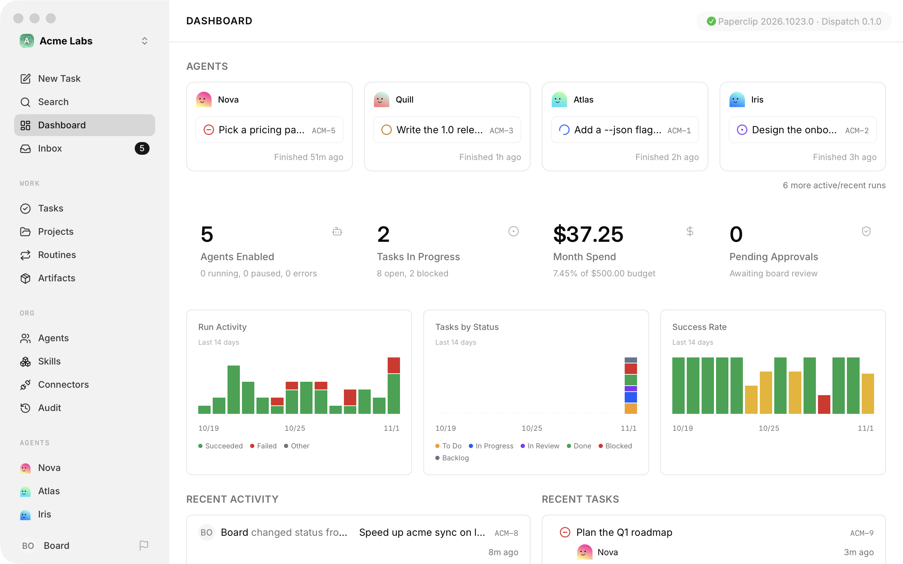
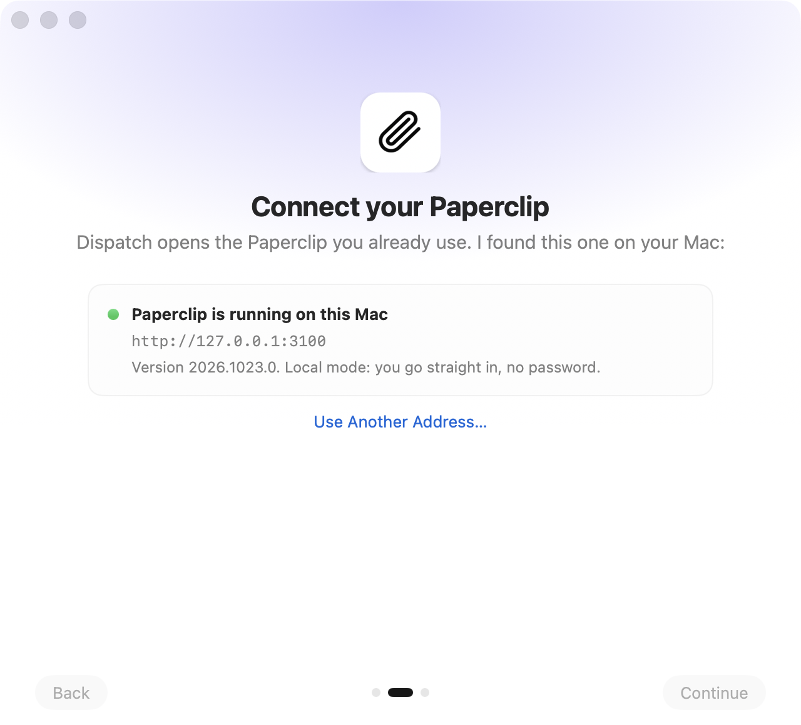
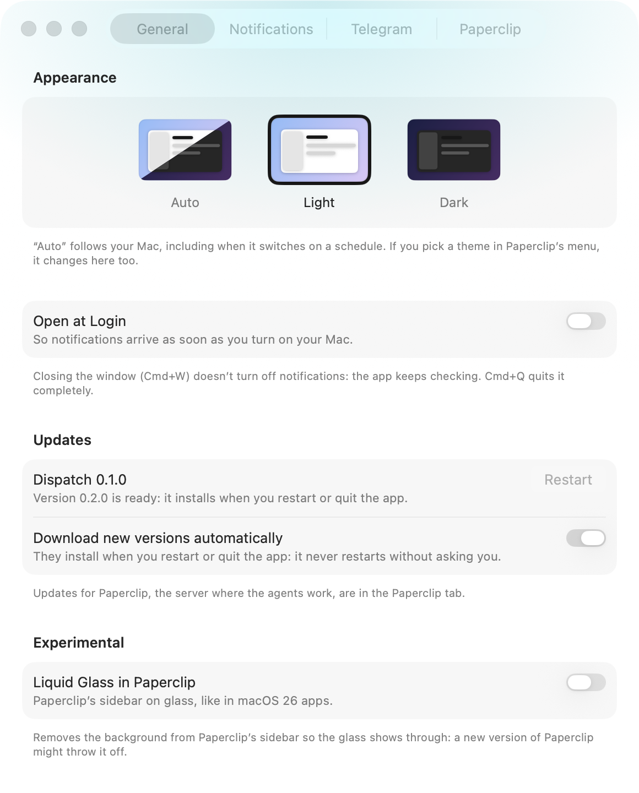

<div align="center">


# Paperclip Dispatch

**Una app nativa de macOS para [Paperclip](https://paperclip.ing): tu Paperclip en su propia ventana, con
avisos de decisiones, número en el Dock y respuestas desde Telegram.**

[Sitio web](https://javiervinus.github.io/paperclip-dispatch/es/) ·
[Descargar](https://github.com/Javiervinus/paperclip-dispatch/releases/latest) ·
[Instalar con Homebrew](#instalación) ·
[Compilar desde el código](#compilar-desde-el-código) ·
[English](README.md)

[](https://github.com/Javiervinus/paperclip-dispatch/actions/workflows/build.yml)
[](https://github.com/Javiervinus/paperclip-dispatch/releases/latest)

[](LICENSE)

<picture>
  <source media="(prefers-color-scheme: dark)" srcset="docs/images/window-dark.png">
  
</picture>

</div>

> [!NOTE]
> Paperclip Dispatch es un proyecto independiente. No lo hace, respalda ni mantiene el equipo de Paperclip.
> «Paperclip» y su logo son de sus dueños.

## Qué es

[Paperclip](https://paperclip.ing) organiza tus agentes de IA como una empresa: tareas, aprobaciones,
presupuestos y las decisiones que los agentes necesitan de ti. Corre como un servidor local y se usa desde
una pestaña del navegador.

Paperclip Dispatch convierte esa pestaña en una app de la Mac. Abre tu propio Paperclip (en esta Mac o en
cualquier dirección a la que llegues), lo pone en toda la ventana y suma lo que una pestaña no puede: avisos
cuando un agente te necesita, aun con la ventana cerrada, el número en el Dock, Telegram y un solo lugar
para actualizar la app y Paperclip. No cambia Paperclip: el servidor, sus datos y sus agentes siguen
corriendo por su cuenta, y cerrar la app no detiene nada.

## Qué hace

- **Paperclip en una ventana de la Mac.** Paperclip ocupa la ventana entera, sin barra de título. La app
  suma los menús y atajos de la Mac (atrás, adelante, inicio, copiar enlace), la navegación con dos dedos
  y, si quieres, una barra lateral con Liquid Glass.
- **Plugins con IA y avisos en la Mac.** Los plugins de Paperclip que escriben con la IA integrada de
  Chrome (su Prompt API) funcionan en la app con Apple Intelligence, el modelo que corre en esta Mac. Los que
  avisan con la API web de avisos mandan avisos de la Mac, cuando los permites como en un navegador.
- **Avisos de decisiones.** Cuando un agente hace una pregunta, pide una aprobación, falla o llega a una
  alerta de presupuesto, recibes un aviso de macOS. Al tocarlo se abre esa decisión. La app revisa cada
  minuto por su cuenta, así que sigue avisando con la ventana cerrada.
- **Despertar una tarea trabada.** Cuando una tarea queda a nombre de un agente que no está trabajando en
  ella, el aviso y el mensaje de Telegram traen el botón **Despertar a &lt;agente&gt;** y después te dicen si
  Paperclip despertó al agente o lo saltó.
- **Número en el Dock.** El ícono del Dock muestra el mismo número que Decisions en la barra lateral de
  Paperclip.
- **Responder desde Telegram.** Conecta tu propio bot de Telegram y cada decisión te llega al teléfono con
  sus botones: aprobar, rechazar, contestar una pregunta o responder con un comentario. Funciona sin
  Tailscale y sin una dirección pública.
- **«Explícamela».** En Telegram, un toque resume una decisión en pocas líneas (de qué trata la tarea, qué
  hizo el agente, qué pide y qué significa cada opción) con un CLI que ya tengas en la Mac: Claude Code,
  Codex, OpenCode o un comando que elijas.
- **Configuración guiada.** La primera vez, la app encuentra Paperclip en esta Mac, lo enciende si está
  apagado, te ayuda a instalarlo si falta o acepta otra dirección. Muestra cómo se ven los avisos antes de
  pedir el permiso.
- **Actualizaciones en un solo lugar.** Un solo botón muestra la versión de la app y la de Paperclip. La
  app descarga sus versiones nuevas en segundo plano y las instala solo cuando la reinicias o la cierras.
  Paperclip se actualiza solo cuando lo pides, igual que sus plugins instalados desde npm, desde un botón
  chico propio a su lado. Cuando sale una
  versión nueva, la app te avisa una vez y sin sonido: en la ventana si la estás mirando y, si no, con un
  aviso de la Mac.
- **Sin conexión, sin pantalla en blanco.** Si Paperclip deja de responder, la ventana lo dice, sigue
  probando y vuelve sola.
- **En inglés y en español.** La app sigue el idioma de la Mac, y el bot de Telegram y sus resúmenes de
  «Explícamela» también.

<p align="center">
  <picture>
    <source media="(prefers-color-scheme: dark)" srcset="docs/images/window-glass-dark.png">
    
  </picture>
  <picture>
    <source media="(prefers-color-scheme: dark)" srcset="docs/images/welcome-dark.png">
    
  </picture>
  <picture>
    <source media="(prefers-color-scheme: dark)" srcset="docs/images/settings-dark.png">
    
  </picture>
</p>
<p align="center">
  <picture>
    <source media="(prefers-color-scheme: dark)" srcset="docs/images/notification-dark.png">
    
  </picture>
</p>

## Requisitos

- **macOS 26 Tahoe** o posterior, en Apple silicon o Intel.
- **Paperclip funcionando**, en esta Mac o en una dirección a la que esta Mac llegue (por ejemplo, en tu red
  local o por [Tailscale](https://tailscale.com)). Si todavía no lo tienes, la app puede abrir el instalador
  oficial (`npx paperclipai@latest onboard --yes`, que pide Node.js 24.11 o posterior).

## Instalación

**Homebrew**

```sh
brew install --cask javiervinus/tap/paperclip-dispatch
```

**Descarga**

Baja el DMG de la [última versión](https://github.com/Javiervinus/paperclip-dispatch/releases/latest),
ábrelo y arrastra **Paperclip Dispatch** a Aplicaciones. La app va firmada y notarizada por Apple.

Después, la app se actualiza sola. Homebrew lo sabe (`auto_updates`), así que `brew upgrade` no la toca
salvo que uses `--greedy`.

**Desinstalar**

Cierra la app y muévela a la Papelera, o corre `brew uninstall --cask paperclip-dispatch`. Para borrar
también sus ajustes, la sesión guardada y los datos de Telegram, usa
`brew uninstall --zap --cask paperclip-dispatch`. El token del bot de Telegram está en tu llavero de inicio
de sesión, con el identificador de la app (`com.javiervinueza.paperclip-dispatch`): quítalo en Ajustes →
Telegram antes de desinstalar, o en Acceso a Llaveros.

## Primeros pasos

1. **Abre la app.** La bienvenida busca Paperclip donde lo deja su CLI (`~/.paperclip/instances/<id>/`, o
   `PAPERCLIP_HOME` y `PAPERCLIP_INSTANCE_ID`) y lo comprueba con `GET /api/health`.
2. **Conéctate.** Si Paperclip está corriendo, ábrelo. Si está instalado pero apagado, la app lo enciende
   (con su servicio de launchd, si lo tiene). Si está en otro lado, escribe su dirección.
3. **Inicia sesión** en Paperclip como siempre, si tu instancia lo pide. La app guarda la sesión.
4. **Permite los avisos** en el último paso, o después en Ajustes → Avisos.
5. **Opcional: Telegram.** En Ajustes → Telegram, pega el token de un bot de
   [@BotFather](https://t.me/BotFather) y escanea el QR para vincular tu chat.

La dirección de Paperclip se cambia cuando quieras en Ajustes → Paperclip.

## Privacidad

Paperclip Dispatch no tiene servidores y no recoge nada. Solo habla con:

- **Tu Paperclip**, con tu sesión, por la misma API que usan las páginas de Paperclip.
- **GitHub**, para buscar versiones nuevas de la app (el appcast de la última versión).
- **Telegram**, solo si conectas un bot. El token queda en tu llavero y el bot solo le contesta al chat que
  vinculas.
- **El CLI que elijas para «Explícamela»**, solo cuando lo tocas. Ese CLI manda el contexto de la decisión a
  su propio proveedor, con tu cuenta.

## Cómo funciona

La app es un paquete de Swift 6 con AppKit y SwiftUI, compilado con SwiftPM (sin proyecto de Xcode). Las
páginas de Paperclip se cargan en un `WKWebView`; unos pocos scripts y estilos las acomodan a una ventana
sin barra de título.

| Parte | Dónde |
| --- | --- |
| Ciclo de vida y menús | `AppDelegate.swift`, `MainMenu.swift`, `AboutPanel.swift` |
| Ventana y vista web | `MainWindowController.swift`, `PaperclipWebView.swift`, `GlassPanel.swift`, `OfflineView.swift` |
| Scripts y estilos que se inyectan en Paperclip | `macos/web/` (`layout.css`, `layout.js`, `glass.css`, `bridge.js`, `language-model.js`, `notifications.js`), listados en `WebResources.swift` |
| Encontrar, encender y comprobar Paperclip | `PaperclipLocator.swift`, `PaperclipAPI.swift` |
| Bienvenida | `WelcomeView.swift`, `WelcomeIntroStep.swift`, `WelcomeNotificationsStep.swift` |
| Decisiones, avisos y número del Dock | `DecisionsMonitor.swift`, `Attention.swift`, `NotificationBridge.swift` |
| Telegram | `TelegramChannel.swift`, `TelegramBotAPI.swift`, `DecisionResolver.swift`, `DecisionExplainer.swift`, `Keychain.swift` |
| Actualizaciones de la app (Sparkle), de Paperclip y de sus plugins | `AppUpdater.swift`, `UpdateController.swift`, `PluginUpdates.swift`, `PluginsButton.swift`, `PluginsPanel.swift`, `UpdateNotices.swift`, `UpdatePill.swift`, `UpdatesButton.swift`, `UpdatesPanel.swift` |
| Ajustes | `SettingsWindowController.swift`, `SettingsView.swift`, `TelegramSettings.swift` |

Todos los archivos de Swift están en `macos/Sources/PaperclipDispatch`. Como la app retoca las páginas de
Paperclip desde fuera, una versión nueva de Paperclip puede descuadrar algo; el arreglo va en `macos/web/`.

## Compilar desde el código

Necesitas macOS 26 y **Xcode 26** (por el SDK de macOS 26, Swift 6.2, `actool` y el `ictool` de Icon
Composer).

```sh
git clone https://github.com/Javiervinus/paperclip-dispatch.git
cd paperclip-dispatch
macos/build.sh
```

`macos/build.sh` compila con `swift build`, arma el `.app` (Info.plist, ícono, Sparkle, recursos web), lo
firma y lo instala en `/Applications`. Si esa copia está abierta, la cierra justo antes de reemplazarla y
la vuelve a abrir. Firma con la primera identidad «Developer ID Application» de tu llavero o, si no hay
ninguna, sin identidad (ad hoc).

Para compilar sin instalar:

```sh
OUTPUT_DIR=/tmp/dispatch macos/build.sh
```

Variables útiles (todas opcionales; la lista completa está al principio de `macos/build.sh`):

| Variable | Por defecto | Qué hace |
| --- | --- | --- |
| `APP_NAME` | `Paperclip Dispatch` | Nombre de la app y del `.app` |
| `APP_ID` | `com.javiervinueza.paperclip-dispatch` | Identificador. Usa otro para una copia de prueba: tiene sus propios ajustes, sesión y llavero |
| `INSTALL_DIR` | `/Applications` | Dónde instalar |
| `OUTPUT_DIR` | vacía | Con valor, deja el `.app` ahí y no instala |
| `UNIVERSAL` | `0` | `1` compila para Apple silicon e Intel |
| `SIGN_IDENTITY` | la primera Developer ID | `-` firma ad hoc |
| `PAPERCLIP_SERVER_URL` | vacía | Una dirección que la app adopta la primera vez |
| `PAPERCLIP_UPDATE_SCRIPT` | vacía | Un script para actualizar Paperclip en vez de `paperclipai update` |

Lo de una Mac en particular va en `macos/build.local.env`, que git ignora. Lo que la app dice de sí misma
(repositorio, appcast, llave pública de Sparkle, autor) está en `macos/release.env`. Una compilación local
busca versiones en el appcast publicado, como cualquier versión; compila con `UPDATE_FEED_URL=` (vacía)
para una copia que nunca deba reemplazarse con la publicada.

> [!TIP]
> Una copia de prueba que necesite avisos tiene que correr desde una carpeta de aplicaciones (por ejemplo,
> `INSTALL_DIR=~/Applications`): macOS no entrega los avisos de apps que corren desde `/tmp`.

### Capturas sin tocar la pantalla

`macos/snapshot.zsh` abre una segunda copia, oculta, de la app instalada, dibuja sus ventanas fuera de la
pantalla y las captura con `screencapture -l`, que dibuja el Liquid Glass de verdad. La terminal necesita
el permiso de Grabación de pantalla.

```sh
macos/snapshot.zsh window   [carpeta]   # la ventana principal, normal y con Liquid Glass
macos/snapshot.zsh welcome  [carpeta]   # cada paso de la bienvenida y la vista sin conexión
macos/snapshot.zsh settings [carpeta]   # cada pestaña de Ajustes, en claro y en oscuro
macos/snapshot.zsh about    [carpeta]   # el panel «Acerca de»
macos/snapshot.zsh notifications [carpeta]   # el aviso y el mensaje de Telegram de una tarea trabada, con «Despertar a…»
macos/snapshot.zsh page /<PREFIJO>/dashboard [carpeta]   # cualquier página de Paperclip dentro de la app
```

`APP_LANGUAGE=en` o `APP_LANGUAGE=es` abre la copia en ese idioma sin cambiar el de tu Mac. `APP_PATH`,
`SIZE`, `ANCHORS`, `SHADOW` y `ACTIVE` se explican al principio del script. Cómo se hacen las imágenes de
este README está en [`docs/images/README.md`](docs/images/README.md).

### Skills de agentes

El repo usa dos skills de SwiftUI para agentes de código, fijadas en `skills-lock.json` e instaladas en
`.agents/skills` (con enlaces en `.claude/skills`). Para reponerlas: `npx skills experimental_install`.

## Publicar una versión

Las versiones las arma `macos/release.sh` y se publican en GitHub, donde las encuentran el actualizador de
la app (Sparkle) y el cask de Homebrew.

1. Sube la versión en `macos/VERSION`. Convierte `## Unreleased` de `CHANGELOG.md` y `CHANGELOG.es.md` en
   la sección de esa versión (`## 1.2.0 — 2026-11-01`). Esas notas son lo que se ve en el panel de
   actualizaciones de la app: cada punto es una frase en negrita para quien la usa. Commit y push.
2. `macos/release.sh` arma todo en `macos/dist/<versión>` sin notarizar ni publicar: el DMG, el `.zip` que
   baja el actualizador (firmado con la llave de Sparkle) y `appcast.xml` con las notas en inglés y en
   español. Sirve para revisar una versión antes de publicarla.
3. `macos/release.sh --notarize` la arma tal como se va a publicar: para Apple silicon e Intel, con la app y
   el DMG notarizados y grapados. No toca git, GitHub ni el tap, así que sirve para comprobar la
   notarización antes de publicar.
4. `macos/release.sh --publish` hace lo mismo que `--notarize` y además crea el release en GitHub con los
   tres archivos, marca el commit con `v<versión>` y actualiza el cask de Homebrew en
   [Javiervinus/homebrew-tap](https://github.com/Javiervinus/homebrew-tap) (`version` y `sha256`), que
   commitea y sube.

Lo que arma `release.sh` nunca lleva los ajustes de esta Mac: la compila sin leer `macos/build.local.env` y
deja fuera `PAPERCLIP_SERVER_URL` y `PAPERCLIP_UPDATE_SCRIPT` aunque estén en el entorno. De ese archivo solo
toma lo que hace falta para publicar, como `NOTARY_PROFILE`. `--publish` comprueba
todo antes de compilar: el árbol limpio, `HEAD` subido, una versión nueva, el tap listo para subir y
`NOTARY_PROFILE`. Lo que necesita una sola vez, en la Mac que publica:

- **Un perfil de notarización:** `xcrun notarytool store-credentials <perfil>`, y luego
  `NOTARY_PROFILE=<perfil>`.
- **La llave privada de Sparkle** en el llavero de inicio de sesión (cuenta `paperclip-dispatch`). La mitad
  pública es `UPDATE_PUBLIC_KEY`, en `macos/release.env`. Guarda un respaldo
  (`generate_keys --account paperclip-dispatch -x <archivo>`, en
  `macos/.build/artifacts/sparkle/Sparkle/bin`): sin ella, las copias instaladas rechazan las versiones
  nuevas.
- **El tap** clonado junto a este repo (`../homebrew-tap`), o en cualquier lado con `HOMEBREW_TAP_DIR`. Para
  actualizar el cask a mano: `macos/update-cask.sh <versión> <dmg>`. Para probarlo sin tocar el tap, apunta
  `HOMEBREW_TAP_DIR` a un clon suyo.

### Probar una actualización en local

Arma una copia de prueba con otro `APP_ID` y un appcast local
(`UPDATE_FEED_URL=http://127.0.0.1:8765/appcast.xml`), arma una versión mayor con `macos/release.sh`
(`DIST`, `BASE_URL` apuntando al mismo servidor y `CHANGELOG_EN` / `CHANGELOG_ES` de prueba) y sirve esa
carpeta con `python3 -m http.server 8765 --bind 127.0.0.1`. A una copia ya armada se le cambia el appcast
con `defaults write <identificador> DispatchFeedURL <url>`.

## Contribuir

Los issues y pull requests son bienvenidos. En un error, incluye la versión de la app y la de Paperclip
(las dos están en Ajustes). Si trabajas con un agente de programación, [`AGENTS.md`](AGENTS.md) tiene las
convenciones del proyecto para él (y para ti). Mantén los cambios enfocados, compila con `macos/build.sh` y revisa con
`macos/snapshot.zsh` las ventanas que tocaste. Cada pull request se compila automáticamente en GitHub Actions
([`build.yml`](.github/workflows/build.yml)): corre `macos/build.sh` para Apple silicon e Intel, sin firma de
desarrollador y sin instalar, así que ahí ves si compila. Lo que cambie para quien usa la app lleva una línea
en los dos CHANGELOG, bajo `## Unreleased` (si ese título no está, agrégalo arriba).

## Agradecimientos

- [Paperclip](https://paperclip.ing), alrededor del cual existe esta app.
- [Sparkle](https://sparkle-project.org), por las actualizaciones.

## Licencia

[MIT](LICENSE) © 2026 Javier Vinueza
