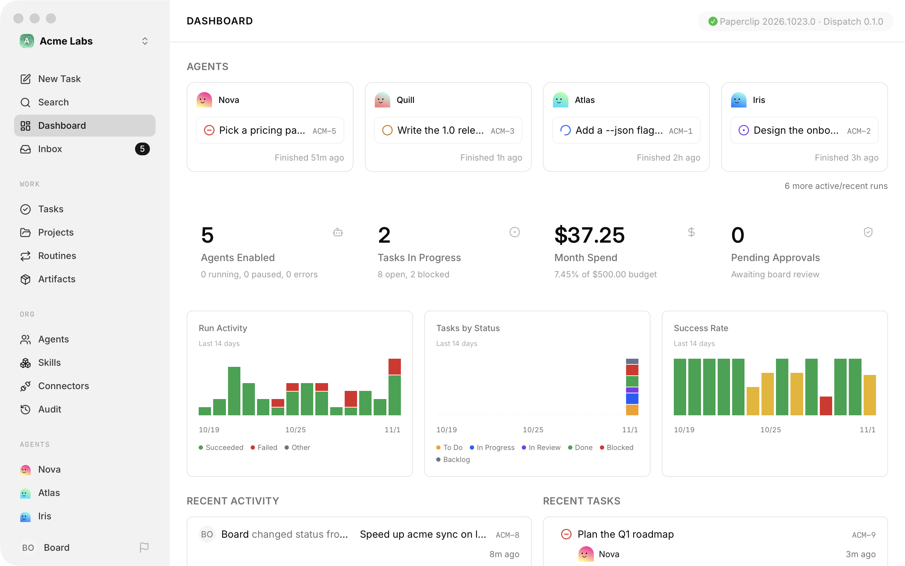
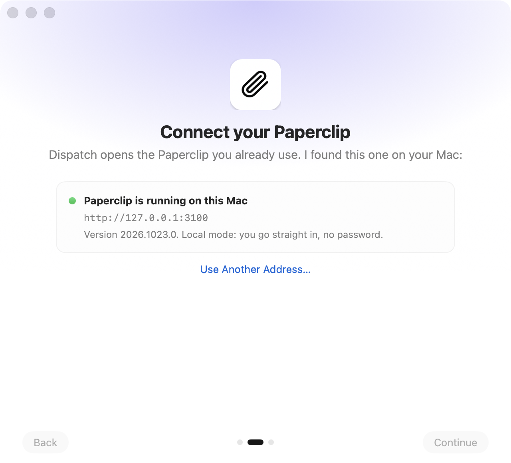
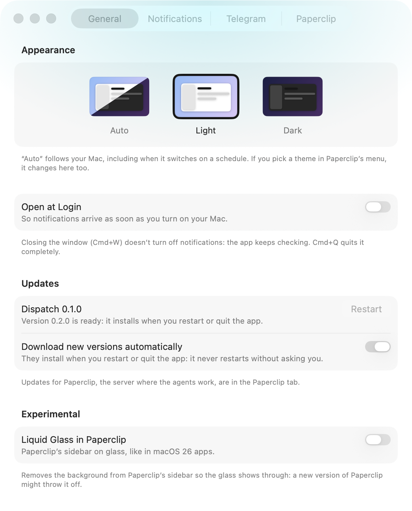

<div align="center">

<!-- Icon: docs/images/icon.png (see docs/images/README.md) -->


# Paperclip Dispatch

**A native macOS app for [Paperclip](https://paperclip.ing): your Paperclip in its own window, with decision
notifications, a Dock badge and answers from Telegram.**

[Download](https://github.com/Javiervinus/paperclip-dispatch/releases/latest) ·
[Install with Homebrew](#install) ·
[Build from source](#build-from-source) ·
[Español](README.es.md)

[](https://github.com/Javiervinus/paperclip-dispatch/actions/workflows/build.yml)
[](https://github.com/Javiervinus/paperclip-dispatch/releases/latest)

[](LICENSE)

<!-- Screenshot: docs/images/window-light.png and docs/images/window-dark.png (see docs/images/README.md) -->
<picture>
  <source media="(prefers-color-scheme: dark)" srcset="docs/images/window-dark.png">
  
</picture>

</div>

> [!NOTE]
> Paperclip Dispatch is an independent project. It is not made, endorsed or supported by the Paperclip
> team. "Paperclip" and its logo belong to their owners.

## What it is

[Paperclip](https://paperclip.ing) runs your AI agents as a company: tasks, approvals, budgets and the
decisions agents need from you. It runs as a local server, and you use it from a browser tab.

Paperclip Dispatch turns that tab into a Mac app. It opens your own Paperclip (on this Mac or at any
address you can reach), fills the window with it, and adds what a browser tab can't: notifications when an
agent needs you, even with the window closed, a Dock badge, Telegram, and one place to update both the
app and Paperclip. It does not change Paperclip: the server, its data and its agents keep running on
their own, and closing the app stops nothing.

## Features

- **Paperclip in a Mac window.** Paperclip fills the whole window, with no title bar. The app adds the
  Mac's menus, shortcuts (back, forward, home, copy link), two-finger swipe navigation and an optional
  Liquid Glass sidebar.
- **Decision notifications.** When an agent asks a question, needs an approval, fails or hits a budget
  alert, you get a macOS notification. Clicking it opens that decision. The app checks every minute on
  its own, so it keeps working with the window closed.
- **Dock badge.** The Dock icon shows the same number as Decisions in Paperclip's sidebar.
- **Answer from Telegram.** Connect your own Telegram bot and each decision arrives on your phone with
  its buttons: approve, reject, answer a question or reply with a comment. Works without Tailscale or a
  public address.
- **"Explain it".** In Telegram, one tap summarizes a decision in a few lines (what the task is, what the
  agent did, what it asks and what each option means), using a coding CLI already on your Mac: Claude
  Code, Codex, OpenCode or a command you choose.
- **Guided setup.** On first launch the app finds Paperclip on this Mac, starts it if it is off, helps you
  install it if it is missing, or takes another address. It shows what notifications look like before
  asking for permission.
- **Updates in one place.** A single button shows the version of the app and of Paperclip. The app
  downloads its own updates in the background and installs them only when you restart it or quit.
  Paperclip updates only when you ask.
- **Works offline gracefully.** If Paperclip stops answering, the window says so, keeps retrying and comes
  back by itself.

<!-- Screenshots: docs/images/window-glass.png, docs/images/welcome.png, docs/images/settings.png -->
<p align="center">
  
  
  
</p>

## Requirements

- **macOS 26 Tahoe** or later, on Apple silicon or Intel.
- **Paperclip running**, on this Mac or at an address this Mac can reach (for example over your local
  network or [Tailscale](https://tailscale.com)). If you don't have it yet, the app can start the official
  installer for you (`npx paperclipai@latest onboard --yes`, which needs Node.js 24.11 or later).

## Install

**Homebrew**

```sh
brew install --cask javiervinus/tap/paperclip-dispatch
```

**Download**

Get the DMG from the [latest release](https://github.com/Javiervinus/paperclip-dispatch/releases/latest),
open it and drag **Paperclip Dispatch** to Applications. The app is signed and notarized by Apple.

After that, the app updates itself. Homebrew knows this (`auto_updates`), so `brew upgrade` leaves it
alone unless you pass `--greedy`.

**Uninstall**

Quit the app and move it to the Trash, or run `brew uninstall --cask paperclip-dispatch`. To also remove
its settings, its saved session and its Telegram data, use `brew uninstall --zap --cask paperclip-dispatch`.
The Telegram bot token lives in your login keychain under the app's bundle id
(`com.javiervinueza.paperclip-dispatch`); remove it in Settings → Telegram before uninstalling, or in
Keychain Access.

## Getting started

1. **Open the app.** The welcome screen looks for Paperclip where its CLI installs it
   (`~/.paperclip/instances/<id>/`, or `PAPERCLIP_HOME` and `PAPERCLIP_INSTANCE_ID`) and checks it with
   `GET /api/health`.
2. **Connect.** If Paperclip is running, open it. If it is installed but off, the app starts it (with its
   launchd service when there is one). If it is somewhere else, type its address.
3. **Sign in** to Paperclip as usual, if your instance asks for it. The app keeps the session.
4. **Allow notifications** in the last step, or later in Settings → Notifications.
5. **Optional: Telegram.** In Settings → Telegram, paste a bot token from
   [@BotFather](https://t.me/BotFather) and scan the QR code to link your chat.

The Paperclip address can be changed at any time in Settings → Paperclip.

## Privacy

Paperclip Dispatch has no servers and collects nothing. It talks only to:

- **Your Paperclip**, with your session, using the same API as Paperclip's own pages.
- **GitHub**, to look for new versions of the app (the appcast of the latest release).
- **Telegram**, only if you connect a bot. The bot token is stored in your keychain, and the bot answers
  only the chat you link.
- **The CLI you pick for "Explain it"**, only when you tap it. That CLI sends the decision's context to
  its own provider, with your account.

## How it works

The app is a Swift 6 package with AppKit and SwiftUI, built with SwiftPM (no Xcode project). Paperclip's
pages load in a `WKWebView`; a few small scripts and styles fit them to a window without a title bar.

| Part | Where |
| --- | --- |
| App lifecycle and menus | `AppDelegate.swift`, `MainMenu.swift`, `AboutPanel.swift` |
| Window and web view | `MainWindowController.swift`, `PaperclipWebView.swift`, `GlassPanel.swift`, `OfflineView.swift` |
| Scripts and styles injected into Paperclip | `macos/web/` (`layout.css`, `layout.js`, `glass.css`, `bridge.js`), listed in `WebResources.swift` |
| Finding, starting and checking Paperclip | `PaperclipLocator.swift`, `PaperclipAPI.swift` |
| Welcome and setup | `WelcomeView.swift`, `WelcomeIntroStep.swift`, `WelcomeNotificationsStep.swift` |
| Decisions, notifications and Dock badge | `DecisionsMonitor.swift`, `Attention.swift`, `NotificationBridge.swift` |
| Telegram | `TelegramChannel.swift`, `TelegramBotAPI.swift`, `DecisionResolver.swift`, `DecisionExplainer.swift`, `Keychain.swift` |
| Updates of the app (Sparkle) and of Paperclip | `AppUpdater.swift`, `UpdateController.swift`, `UpdatesButton.swift`, `UpdatesPanel.swift` |
| Settings | `SettingsWindowController.swift`, `SettingsView.swift`, `TelegramSettings.swift` |

All Swift files are in `macos/Sources/PaperclipDispatch`. Because the app adjusts Paperclip's pages from
the outside, a new Paperclip version can occasionally misalign the layout; the fixes go in `macos/web/`.

## Build from source

You need macOS 26 and **Xcode 26** (for the macOS 26 SDK, Swift 6.2, `actool` and Icon Composer's
`ictool`).

```sh
git clone https://github.com/Javiervinus/paperclip-dispatch.git
cd paperclip-dispatch
macos/build.sh
```

`macos/build.sh` compiles with `swift build`, assembles the `.app` (Info.plist, icon, Sparkle, web
resources), signs it and installs it in `/Applications`. If that copy is running, it quits it just before
replacing it and opens it again. It signs with the first "Developer ID Application" identity in your
keychain, or ad hoc if there is none.

To build without installing:

```sh
OUTPUT_DIR=/tmp/dispatch macos/build.sh
```

Useful variables (all optional; the full list is at the top of `macos/build.sh`):

| Variable | Default | What it does |
| --- | --- | --- |
| `APP_NAME` | `Paperclip Dispatch` | App name and `.app` file name |
| `APP_ID` | `com.javiervinueza.paperclip-dispatch` | Bundle id. Use another one for a test copy: it keeps its own settings, session and keychain item |
| `INSTALL_DIR` | `/Applications` | Where to install |
| `OUTPUT_DIR` | empty | If set, leaves the `.app` there and does not install |
| `UNIVERSAL` | `0` | `1` builds for Apple silicon and Intel |
| `SIGN_IDENTITY` | first Developer ID | `-` signs ad hoc |
| `PAPERCLIP_SERVER_URL` | empty | An address the app adopts on first launch |
| `PAPERCLIP_UPDATE_SCRIPT` | empty | A script to update Paperclip instead of `paperclipai update` |

Settings for one Mac go in `macos/build.local.env`, which is ignored by git. What the app says about
itself (repository, update feed, Sparkle public key, author) is in `macos/release.env`. Local builds look
for updates in the published feed like any release; build with `UPDATE_FEED_URL=` (empty) for a copy that
should never replace itself with the published version.

> [!TIP]
> A test copy that needs notifications must run from an Applications folder (for example
> `INSTALL_DIR=~/Applications`): macOS does not deliver notifications for apps running from `/tmp`.

### Screenshots without touching the screen

`macos/snapshot.zsh` opens a second, hidden copy of the installed app, draws its windows off-screen and
captures them with `screencapture -l`, which renders Liquid Glass faithfully. The terminal needs the
Screen Recording permission.

```sh
macos/snapshot.zsh window   [folder]   # the main window, normal and with Liquid Glass
macos/snapshot.zsh welcome  [folder]   # each welcome step and the offline view
macos/snapshot.zsh settings [folder]   # each Settings tab, light and dark
macos/snapshot.zsh about    [folder]   # the About panel
macos/snapshot.zsh page /<PREFIX>/dashboard [folder]   # any Paperclip page inside the app
```

`APP_PATH`, `SIZE`, `ANCHORS`, `SHADOW` and `ACTIVE` are explained at the top of the script.

### Agent skills

The repo uses two SwiftUI skills for coding agents, pinned in `skills-lock.json` and installed in
`.agents/skills` (linked from `.claude/skills`). To refresh them: `npx skills experimental_install`.

## Releasing

Releases are built by `macos/release.sh` and published on GitHub, where the app's updater (Sparkle) and the
Homebrew cask find them.

1. Raise the version in `macos/VERSION`. Turn `## Unreleased` in `CHANGELOG.md` and `CHANGELOG.es.md` into
   that version's section (`## 1.2.0 — 2026-11-01`). These notes are what users see in the app's updates
   panel, so each item is one bold sentence for the person using the app. Commit and push.
2. `macos/release.sh` builds everything in `macos/dist/<version>` without publishing: the DMG, the `.zip`
   the updater downloads (signed with the Sparkle key) and `appcast.xml` with the notes in English and
   Spanish. Use it to check a release before publishing.
3. `macos/release.sh --publish` also builds for Apple silicon and Intel, notarizes the app and the DMG,
   creates the GitHub release with the three files, tags the commit `v<version>` and updates the Homebrew
   cask in [Javiervinus/homebrew-tap](https://github.com/Javiervinus/homebrew-tap) (`version` and
   `sha256`), which it commits and pushes.

`--publish` checks everything before building: a clean tree, `HEAD` pushed, a new version, the tap ready
to push, and `NOTARY_PROFILE` set. What it needs once, on the Mac that publishes:

- **A notarization profile:** `xcrun notarytool store-credentials <profile>`, then pass
  `NOTARY_PROFILE=<profile>`.
- **The Sparkle private key** in the login keychain (account `paperclip-dispatch`). The public half is
  `UPDATE_PUBLIC_KEY` in `macos/release.env`. Keep a backup
  (`generate_keys --account paperclip-dispatch -x <file>`, from
  `macos/.build/artifacts/sparkle/Sparkle/bin`): without it, installed copies reject new versions.
- **The tap** cloned next to this repo (`../homebrew-tap`), or anywhere with `HOMEBREW_TAP_DIR`. To update
  the cask by hand: `macos/update-cask.sh <version> <dmg>`. To try it without touching the tap, point
  `HOMEBREW_TAP_DIR` at a clone of it.

### Trying an update locally

Build a test copy with another `APP_ID` and a local feed
(`UPDATE_FEED_URL=http://127.0.0.1:8765/appcast.xml`), build a higher version with `macos/release.sh`
(`DIST`, `BASE_URL` pointing at the same server, and test `CHANGELOG_EN` / `CHANGELOG_ES`), and serve that
folder with `python3 -m http.server 8765 --bind 127.0.0.1`. An already built copy can switch feeds with
`defaults write <bundle id> DispatchFeedURL <url>`.

## Contributing

Issues and pull requests are welcome. For bugs, include the app version and your Paperclip version (both are
in Settings). Keep changes focused, build with `macos/build.sh`, and check the windows you touched with
`macos/snapshot.zsh`. Every pull request is built automatically on GitHub Actions
([`build.yml`](.github/workflows/build.yml)), so you'll see there whether it compiles. User-facing changes get
a line in both changelogs under `## Unreleased`.

## Acknowledgements

- [Paperclip](https://paperclip.ing), which this app is built around.
- [Sparkle](https://sparkle-project.org), for app updates.

## License

[MIT](LICENSE) © 2026 Javier Vinueza
